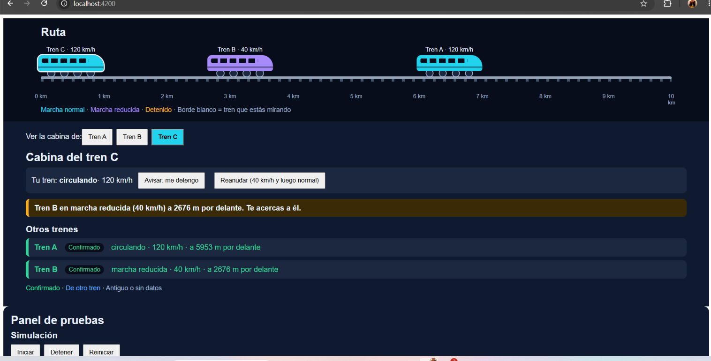

# SICORF

> Con todo mi respeto y mi más sentido pésame a las víctimas del accidente
> ferroviario, a sus familias y a todas las personas afectadas.

**SICORF es un simulador educativo. No es un sistema real ni sustituye a ningún
sistema ferroviario.**

**Demo en línea:** https://gissilovee.github.io/SICORF/
(pulsa **Iniciar** en el panel de pruebas para arrancar la simulación)

## Cómo funciona

Tres trenes (A, B y C) circulan por una ruta de 10 km. Cada tren emite por una
radio simulada su posición, velocidad y estado. Cada cabina guarda lo que oye de
los demás trenes y lo muestra al maquinista con avisos:

- Tren detenido por delante.
- Tren en marcha reducida (40 km/h durante unos segundos y después marcha
  normal). Si vas más rápido que él, el aviso sube de prioridad.
- Dato antiguo o ausencia de datos. Que falte información nunca se interpreta
  como situación segura.
- Contradicción entre lo que dice un centro de control simulado y lo que informa
  el propio tren.

Desde el panel de pruebas se puede parar y arrancar trenes, ponerlos en marcha
reducida, apagar o hacer que se equivoque el centro de control y empeorar la
radio, para ver cómo reaccionan las cabinas.

## Qué no es

- No es un sistema de seguridad ni está certificado.
- No sustituye ni pretende sustituir ningún sistema de Adif, ni de ninguna otra
  entidad o empresa ferroviaria.
- No usa datos reales y no tiene relación con Adif ni con ningún organismo.
- No analiza las causas del accidente ni afirma que algo habría podido evitarlo.

## Por qué existe

Es un ejercicio personal de simulación y diseño de interfaz que nació de lo
mucho que me hizo pensar el accidente. Lo comparto con respeto, por si la idea de
que las pantallas de cabina muestren información de otros trenes sirve de
inspiración a alguien del sector con capacidad para estudiarla de verdad.

## Tecnología

Angular y TypeScript.

## Cómo ejecutarlo en local

    npm install
    ng serve

Después abre http://localhost:4200